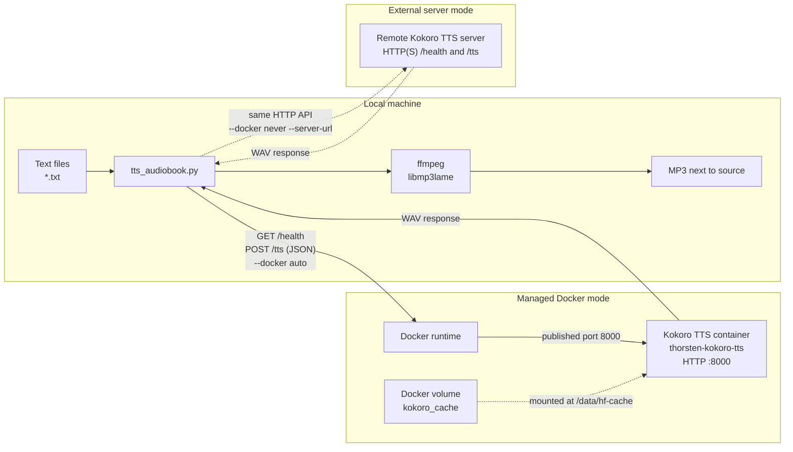
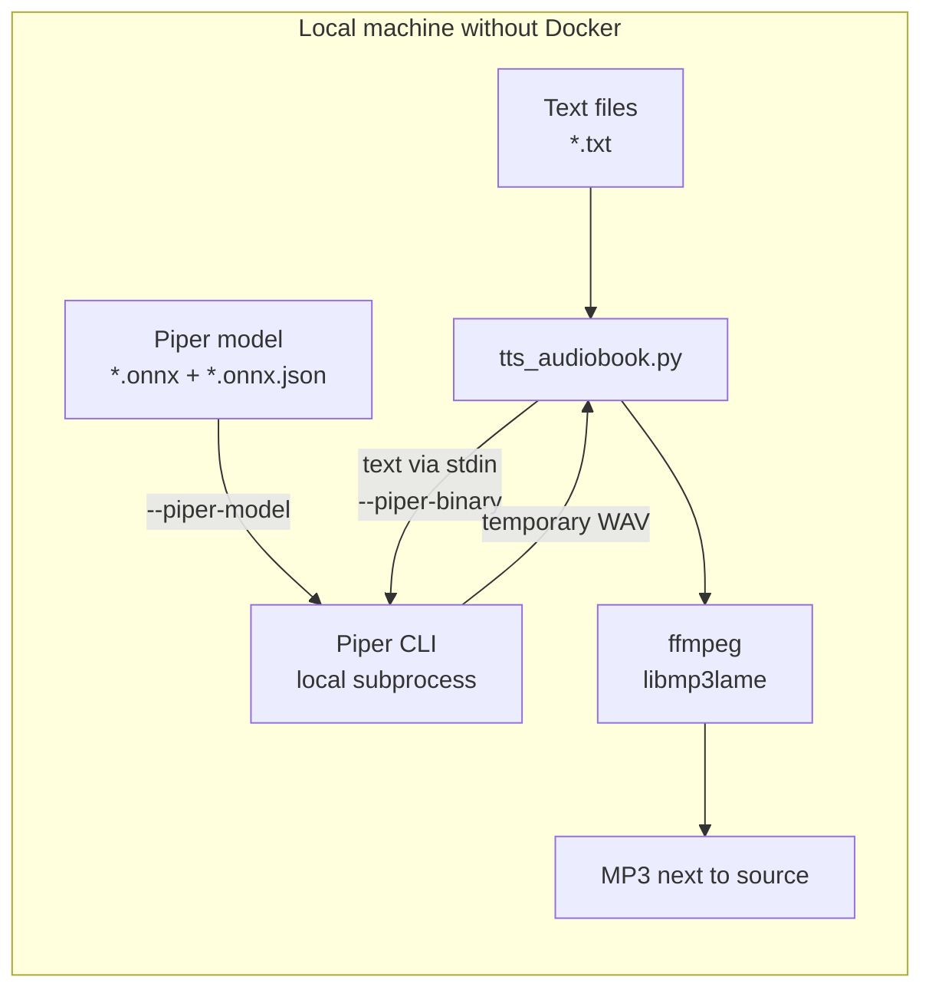

# German Audiobook Generator

Generate German audiobook MP3s from `.txt` files with Thorsten-Voice CosyVoice3, Kokoro, or Piper. Each source file becomes an MP3 with the same filename stem in the same directory.

For the easiest first run, **Kokoro is recommended**: it has good quality, runs quickly on a CPU, and requires less setup and download space than CosyVoice. Piper is the lightest option and does not need Docker. CosyVoice provides the highest quality but has the largest download and benefits strongly from a capable NVIDIA GPU.

## Quick Start

This example uses Kokoro on Linux. Run it from the repository root. It requires Python 3.9 or newer, ffmpeg, and Docker:

```bash
sudo apt update
sudo apt install python3 ffmpeg docker.io
sudo usermod -aG docker "$USER"
```

Log out and back in after changing the Docker group, then verify the installation:

```bash
python3 --version
ffmpeg -version
docker info
```

Replace `path/to/chapter.txt` in the commands below with the actual path to a German text file. First preview the operation without starting Docker or downloading a model:

```bash
python3 tts_audiobook.py --engine kokoro \
  --text-file path/to/chapter.txt --dry-run
```

Generate the MP3:

```bash
python3 tts_audiobook.py --engine kokoro \
  --text-file path/to/chapter.txt
```

The result is written to `path/to/chapter.mp3`. Kokoro's first start downloads a few hundred MB of model data; later starts reuse the Docker volume `kokoro_cache`.

To convert every `.txt` file in a directory:

```bash
python3 tts_audiobook.py --engine kokoro \
  --text-dir path/to/texts
```

Existing non-empty MP3s are skipped. Add `--force` to regenerate them.

On macOS or Apple Silicon, start with the [macOS setup appendix](#appendix-macos-and-apple-silicon).

## Contents

- [Choose an Engine](#choose-an-engine)
- [Requirements](#requirements)
- [Basic Usage](#basic-usage)
- [Kokoro](#kokoro)
- [Piper](#piper)
- [CosyVoice](#cosyvoice)
- [Processing and Output](#processing-and-output)
- [CLI Option Summary](#cli-option-summary)
- [Docker and Server Operation](#docker-and-server-operation)
- [CosyVoice GPU Support on Linux](#cosyvoice-gpu-support-on-linux)
- [Using an External GPU Host](#using-an-external-gpu-host)
- [Troubleshooting](#troubleshooting)
- [macOS and Apple Silicon](#appendix-macos-and-apple-silicon)

## Choose an Engine

| Engine | Best for | Quality | Hardware | Backend | First-run cost |
| --- | --- | --- | --- | --- | --- |
| [`kokoro`](#kokoro) | Easy general-purpose use | Good | CPU, real time or faster | Managed Docker container or external HTTP server | A few hundred MB of model data |
| [`piper`](#piper) | Weak hardware and long books | Good, lightweight | CPU, very fast | Local Piper CLI | Piper package plus a 20-120 MB model |
| [`cosyvoice`](#cosyvoice) | Highest voice quality | Highest | Capable NVIDIA GPU recommended; CPU is slow | Managed Docker container or external HTTP server | About 19 GB image plus about 9 GB of models |

The CLI default is `cosyvoice`; choose Kokoro or Piper explicitly with `--engine`.

A 2 GB GPU is not sufficient for CosyVoice3 and fails with CUDA out of memory. Use Kokoro or Piper instead, or run CosyVoice on the CPU with `--gpu off`. CosyVoice CPU inference can take minutes per short text and much longer per chapter.

## Requirements

| Component | Required for |
| --- | --- |
| Python 3.9 or newer | All engines |
| ffmpeg with `libmp3lame` | All engines |
| Docker Engine or Docker Desktop | Locally managed CosyVoice and Kokoro containers |
| NVIDIA driver plus NVIDIA Container Toolkit or CDI | Optional CosyVoice GPU acceleration on Linux |
| Piper executable and German voice model | Piper |

The generator itself uses only the Python standard library. Local Docker is not required when CosyVoice or Kokoro is provided by an existing HTTP server with `--docker never`.

Install the common Linux packages:

```bash
sudo apt install python3 ffmpeg
```

Install Docker for a locally managed CosyVoice or Kokoro container:

```bash
sudo apt install docker.io
```

If Docker reports permission denied, add the current user to the Docker group and log in again:

```bash
sudo usermod -aG docker "$USER"
```

Run these commands from the repository root. The repository does not mark `tts_audiobook.py` as executable, so the documented commands use `python3 tts_audiobook.py`. Alternatively, run `chmod +x tts_audiobook.py` once if you prefer `./tts_audiobook.py`.

## Basic Usage

### Convert One File

```bash
python3 tts_audiobook.py --engine kokoro \
  --text-file path/to/chapter.txt
```

### Convert a Directory

```bash
python3 tts_audiobook.py --engine kokoro \
  --text-dir path/to/texts
```

### Convert Selected Files

```bash
python3 tts_audiobook.py --engine kokoro --text-file \
  path/to/chapter-01.txt \
  path/to/chapter-02.txt
```

`--text-dir` and `--text-file` are aliases for the same input option. Each accepts one or more directories or `.txt` files, and either option may be repeated. Inputs are processed in CLI order, files discovered in a directory are naturally sorted, and duplicate resolved paths are processed only once.

At least one input path is required. If it is omitted, argument parsing fails before Docker, Piper, or any TTS server is contacted.

`--glob` and `--recursive` apply to directory inputs. They are rejected when every input is an explicit file. Every directory input must contain at least one matching `.txt` file.

Search subdirectories or select a different filename pattern:

```bash
python3 tts_audiobook.py --engine kokoro \
  --text-dir path/to/texts --recursive --glob 'chapter-*.txt'
```

### Preview Without Starting an Engine

```bash
python3 tts_audiobook.py --engine kokoro \
  --text-dir path/to/texts --dry-run
```

`--dry-run` shows file selection and planned output without contacting Docker, Piper, or a TTS server.

### Regenerate Existing MP3s

```bash
python3 tts_audiobook.py --engine kokoro \
  --text-dir path/to/texts --force
```

`--overwrite` is an alias for `--force`.

### Change Speed or Add a Cooldown

```bash
python3 tts_audiobook.py --engine kokoro \
  --text-dir path/to/texts --speed 0.9
```

Pause for two minutes after each generated chapter, including the last:

```bash
python3 tts_audiobook.py --engine kokoro \
  --text-dir path/to/texts --cooldown 120
```

Skipped or failed files do not trigger a cooldown.

## Kokoro

Kokoro is the recommended compromise when CosyVoice is too slow or the GPU has too little memory. It runs on the CPU; `--gpu on` is rejected and `--gpu auto` uses the CPU.

```bash
python3 tts_audiobook.py --engine kokoro \
  --text-dir path/to/texts
```

The script starts or reuses the container `thorsten-kokoro-tts` from `thorstenvoice/kokoro-tts:latest`. Model data is cached in the Docker volume `kokoro_cache`. The image is multi-arch; see the [macOS appendix](#appendix-macos-and-apple-silicon) for Apple-specific notes.

### Kokoro Data Flow



By default, `--docker auto` starts the managed container. With `--docker never --server-url URL`, the script skips Docker and sends the same `/health` and `/tts` HTTP requests to an external Kokoro server.

Choose a training checkpoint from 1 to 10:

```bash
python3 tts_audiobook.py --engine kokoro \
  --text-dir path/to/texts --kokoro-epoch 10
```

The managed container receives the selected checkpoint as `KOKORO_EPOCH`. A matching existing container is reused. If an existing container uses a different epoch, the script refuses to reuse it; add `--recreate` to replace that container while retaining the model volume.

Change the host port:

```bash
python3 tts_audiobook.py --engine kokoro \
  --text-dir path/to/texts --port 9000
```

Kokoro always listens on port `8000` inside the container. `--port 9000` maps host port `9000` to it.

## Piper

Piper is the fastest and lightest option. Synthesis runs locally without Docker or a TTS-server connection; installation and model download may require internet access. Piper is CPU-only in this script, and `--gpu on` is rejected.

### Piper Data Flow



Piper runs as a local subprocess and writes a temporary WAV that the script converts with ffmpeg. No Docker runtime or HTTP service is involved.

### Install Piper

The recommended installation is a virtual environment. On Debian or Ubuntu, install virtual-environment support and `curl` first if needed:

```bash
sudo apt install python3-venv curl
```

Then create the environment and install Piper:

```bash
python3 -m venv .venv-piper
.venv-piper/bin/pip install piper-tts
```

Pass the virtual-environment executable explicitly with `--piper-binary .venv-piper/bin/piper`. Alternatively, activate the environment so `piper` is on `PATH`, or install `piper-tts` with `pipx`. The script automatically uses `piper` from `PATH` or, if that is unavailable, `python3 -m piper`.

If you use the standalone Piper release from the Thorsten-Voice instructions, keep the complete extracted directory together and pass its executable explicitly:

```bash
python3 tts_audiobook.py --engine piper \
  --piper-binary tools/piper/piper \
  --piper-model models/de_DE-thorsten-high.onnx \
  --text-dir path/to/texts
```

### Download a German Voice

Download the `.onnx` model and its `.onnx.json` configuration into the same directory. For example, download the neutral high German Thorsten voice:

```bash
mkdir -p models
curl -L -o models/de_DE-thorsten-high.onnx \
  "https://huggingface.co/rhasspy/piper-voices/resolve/v1.0.0/de/de_DE/thorsten/high/de_DE-thorsten-high.onnx?download=true"
curl -L -o models/de_DE-thorsten-high.onnx.json \
  "https://huggingface.co/rhasspy/piper-voices/resolve/v1.0.0/de/de_DE/thorsten/high/de_DE-thorsten-high.onnx.json"
```

The model and configuration must keep the same base name. The script verifies that `<model>.json` exists.

Generate an audiobook:

```bash
python3 tts_audiobook.py --engine piper \
  --piper-binary .venv-piper/bin/piper \
  --piper-model models/de_DE-thorsten-high.onnx \
  --text-dir path/to/texts
```

### Piper Speed and Speakers

`--speed` maps to Piper's inverse length scale. For example, `--speed 0.8` becomes `--length_scale 1.25`. Set the length scale directly when needed:

```bash
python3 tts_audiobook.py --engine piper \
  --piper-model models/de_DE-thorsten-high.onnx \
  --piper-length-scale 1.1 \
  --text-dir path/to/texts
```

For the emotional Piper model, select a speaker:

```bash
python3 tts_audiobook.py --engine piper \
  --piper-model models/de_DE-thorsten_emotional-medium.onnx \
  --piper-speaker 1 \
  --text-dir path/to/texts
```

Do not pass `--piper-speaker` for the high German or Hessian models.

Piper reloads the model once per chapter. This is still fast. A persistent Piper HTTP server can be faster for very large projects, but using such a server is outside this script's Piper workflow.

## CosyVoice

CosyVoice provides the highest quality, but it is compute-heavy and has a large first-run download. It is also the default engine, so `--engine cosyvoice` may be omitted.

The Docker/HTTP plumbing and data flow are the same as for Kokoro, including the optional external-server path. See the [Kokoro data-flow diagram](#kokoro-data-flow). For CosyVoice, the engine details change: image `thorstenvoice/cosyvoice-tts:cosyvoice3`, container `cosyvoice-tts`, volume `cosyvoice_models`, and multipart form data for `/tts` instead of JSON. The larger first-run downloads and GPU behavior are described below.

### First Run

Use a longer startup timeout while the image and models are downloaded:

```bash
python3 tts_audiobook.py --text-dir path/to/texts \
  --start-timeout 14400
```

The first run pulls `thorstenvoice/cosyvoice-tts:cosyvoice3`, which occupies about 19 GB after extraction, and downloads about 9 GB of pretrained models. Depending on the connection, this can take 15 minutes to several hours. The models are cached in the Docker volume `cosyvoice_models`; later starts are much faster.

The default `--start-timeout 1800` can expire during the first download. Use a larger value such as `14400` for the first start. If startup times out, rerunning the same command is safe because completed data remains in the named volume. See [download recovery](#the-first-cosyvoice-model-download-was-interrupted) if subsequent starts fail or restart repeatedly.

If the host has no suitable GPU, force CPU operation:

```bash
python3 tts_audiobook.py --text-dir path/to/texts \
  --gpu off --start-timeout 14400
```

On a 2 GB GPU, also add `--recreate` if an existing container was originally created with GPU access. Existing containers are reused without changing their GPU configuration.

If Docker bridge networking is broken, use host networking with the default port:

```bash
python3 tts_audiobook.py --text-dir path/to/texts \
  --docker-network host --port 8000
```

### German Number Handling

When its WeText frontend is available, the bundled CosyVoice image normalizes German digits with English number words. The client therefore spells numbers in German before sending text to CosyVoice by default:

- `C96` becomes `C sechsundneunzig`
- `1887` becomes `achtzehnhundertsiebenundachtzig`
- `08/15` becomes `null acht fünfzehn`
- `7,63` becomes `sieben Komma sechs drei`
- patent numbers after `Nummer` or `Patentschrift` are read digit by digit

Use `--spell-numbers off` to send digits unchanged. Use `--spell-numbers de` to apply the same preprocessing to Kokoro or Piper. Number spelling happens before CosyVoice blank-line normalization and before the request body is built.

### Normalization Fields

The client accepts `--normalize-text`, `--normalize-loudness`, and `--lufs-target` for compatible external servers. The bundled Thorsten-Voice image reads only `text` and `speed`, so it ignores these normalization fields.

## Processing and Output

For each run, the script:

1. Resolves the input paths and collects matching `.txt` files.
2. Skips existing non-empty MP3s unless `--force` or `--overwrite` is set.
3. Checks `/health` for CosyVoice or Kokoro.
4. Starts or reuses the engine-specific container when a local server is unavailable and `--docker auto` is active. An unreachable remote URL is never started automatically.
5. Optionally spells numbers in German; `auto` enables this for CosyVoice only.
6. Sends one synthesis request per chapter. CosyVoice sends multipart form data to `/tts`, Kokoro sends JSON to `/tts`, and Piper receives text on standard input.
7. Validates the returned WAV and converts it to MP3 with ffmpeg.
8. Atomically moves the completed MP3 next to the source file.
9. Prints playback duration, file size, and render time for each generated file.
10. Continues after failed chapters and exits non-zero if any chapter failed.
11. Stops a managed Docker container on exit, including on errors and Ctrl+C. An external server used with `--docker never` is left untouched.

The script intentionally sends one request per chapter. It does not split chapters because CosyVoice handles long text internally and chunk boundaries can hurt prosody. Progress inside a single long CosyVoice request cannot be reported.

For `path/to/chapter.txt`, the output is `path/to/chapter.mp3`. Temporary WAV files are removed automatically. The MP3 is first written to a temporary file in the destination directory and then atomically renamed, so interruption does not leave a partial final MP3.

Unless `--no-tags` is used, each MP3 receives ID3 tags:

- title derived from the filename without its numeric prefix
- track number derived from the numeric filename prefix
- artist `Thorsten-Voice` by default
- album from `--album`, when set

## CLI Option Summary

| Option | Default | Description |
| --- | --- | --- |
| `--text-dir PATH [PATH ...]`, `--text-file PATH [PATH ...]` | required | One or more directories or `.txt` files; may be repeated. |
| `--glob PATTERN` | `*.txt` | File selection pattern for directory inputs. |
| `--recursive` | off | Search subdirectories of directory inputs. |
| `--force`, `--overwrite` | off | Regenerate MP3s even when they already exist. |
| `--dry-run` | off | Show planned actions without contacting Docker or the server. |
| `--cooldown SECONDS` | `0` | Pause after each generated MP3, including the last. |
| `--engine ENGINE` | `cosyvoice` | `cosyvoice`, `kokoro`, or `piper`. |
| `--speed FLOAT` | `1.0` | Speaking speed from `0.5` to `2.0`; Piper maps this to length scale. |
| `--spell-numbers auto\|de\|off` | `auto` | `auto` spells German numbers for CosyVoice; `de` applies to every engine; `off` leaves digits unchanged. |
| `--kokoro-epoch N` | `5` | Kokoro checkpoint from 1 to 10 for a managed container. |
| `--piper-binary PATH` | auto | Piper executable; otherwise `piper` or `python3 -m piper`. |
| `--piper-model PATH` | required for Piper | Piper `.onnx` model. |
| `--piper-speaker N` | unset | Speaker ID for multi-speaker Piper models. |
| `--piper-length-scale FLOAT` | unset | Direct Piper length scale; overrides `--speed`. |
| `--normalize-text` | off | Sent as `normalize_text`; ignored by the bundled Thorsten-Voice image. |
| `--normalize-loudness` | off | Sent as `normalize_loudness`; ignored by the bundled Thorsten-Voice image. |
| `--lufs-target FLOAT` | `-23.0` | Sent as `lufs_target`; used only by compatible CosyVoice servers. |
| `--server-url URL` | `http://127.0.0.1:8000` | Existing CosyVoice or Kokoro server. |
| `--port PORT` | `8000` or URL port | Docker host port. |
| `--timeout SECONDS` | `7200` | Per-chapter HTTP timeout. |
| `--retries N` | `2` | Retries after transient synthesis failures. |
| `--start-timeout SECONDS` | `1800` | Wait for a newly started container; use about `14400` for the first CosyVoice start. |
| `--mp3-bitrate RATE` | `192k` | MP3 audio bitrate. |
| `--mp3-sample-rate HZ` | `44100` | MP3 sample rate. |
| `--album TEXT` | empty | Optional album ID3 tag. |
| `--artist TEXT` | `Thorsten-Voice` | Artist ID3 tag. |
| `--no-tags` | off | Disable ID3 tags. |
| `--docker auto\|never` | `auto` | Manage a local container or require an existing server. |
| `--docker-network NETWORK` | unset | Docker network mode; use `host` when bridge networking is broken. |
| `--gpu auto\|on\|off` | `auto` | CosyVoice GPU selection. Kokoro and Piper are CPU-only. |
| `--image IMAGE` | engine-specific | Docker image override. |
| `--container-name NAME` | engine-specific | Managed container name override. |
| `--model-volume NAME` | engine-specific | Model-cache volume override. |
| `--recreate` | off | Remove and recreate the managed container; the model volume is retained. |
| `--stop-container` | on | Accepted for compatibility; managed containers are always stopped on exit. |

Run `python3 tts_audiobook.py --help` for the parser's complete help output.

## Docker and Server Operation

### Managed Container Defaults

| Engine | Image | Container | Model volume |
| --- | --- | --- | --- |
| CosyVoice | `thorstenvoice/cosyvoice-tts:cosyvoice3` | `cosyvoice-tts` | `cosyvoice_models` |
| Kokoro | `thorstenvoice/kokoro-tts:latest` | `thorsten-kokoro-tts` | `kokoro_cache` |

CosyVoice publishes the configured host port to the same container port and sets `PORT`. Kokoro maps the configured host port to its internal port `8000`.

### Container Lifecycle

- A running managed container is reused and is not restarted unless `--recreate` is set.
- A stopped managed container is started again.
- A missing image is pulled, and a missing container and named model volume are created automatically.
- The managed container is stopped when the script exits normally, fails, receives Ctrl+C, SIGTERM, or SIGHUP. This also applies when it was already running before the script started.
- SIGKILL and power loss cannot be handled; the container may remain running.
- An external server used with `--docker never` is never stopped or otherwise managed.

### Use an Existing Server

```bash
python3 tts_audiobook.py --engine kokoro \
  --text-dir path/to/texts \
  --docker never \
  --server-url http://127.0.0.1:8000
```

If you want to keep a server running, start it outside the script and use `--docker never`. The external server remains running after generation.

### Ports, Networks, and Recreation

With `--docker-network host`, the managed container is started without `-p` and listens directly on host port `8000`; `--port` must remain `8000`. Switching an existing container between bridge and host networking requires `--recreate`.

An existing container with a different requested port, network mode, or Kokoro epoch is not silently modified. The script reports the mismatch and asks for `--recreate`. Recreation preserves the named model volume. GPU handling depends on the selected mode: `--gpu on` rejects an existing CPU-only container, `auto` may warn and continue with it, and `off` may reuse a GPU-enabled container. Use `--recreate` whenever the existing container's GPU configuration must change.

## CosyVoice GPU Support on Linux

The script uses the GPU only when all of the following are true:

- the engine is CosyVoice
- `--gpu` is not `off`
- the platform is Linux
- `nvidia-smi -L` succeeds
- Docker has an `nvidia` runtime or an NVIDIA CDI specification

The managed container is then started with `--gpus all`. Newer Docker versions can use NVIDIA CDI without a separate `nvidia` runtime.

`--gpu auto` falls back to CPU with a warning when GPU acceleration is unavailable. `--gpu on` fails with diagnostics instead of silently using the CPU. GPU detection does not check VRAM and can select a GPU that is too small; 2 GB is insufficient for CosyVoice3.

Configure the NVIDIA runtime and CDI specification when Docker cannot access the GPU:

```bash
sudo nvidia-ctk runtime configure --runtime=docker
sudo nvidia-ctk cdi generate --output=/etc/cdi/nvidia.yaml
sudo systemctl restart docker
```

If `nvidia-smi` reports a driver/library mismatch, reboot or reload the NVIDIA kernel modules. Reinstall the NVIDIA driver if that does not help.

An existing CPU-only container is not modified automatically. Use `--recreate` to rebuild it with GPU access while retaining the model volume. Conversely, an existing GPU container is reused even with `--gpu off`; use `--recreate` to rebuild it for CPU.

Kokoro and Piper do not use the NVIDIA GPU through this script.

## Using an External GPU Host

A dedicated Linux machine with an NVIDIA GPU can run CosyVoice while the audiobook generator runs on a laptop or another machine. Docker and the GPU configuration remain on the host; the local machine needs only Python, ffmpeg, the project files, and network access to the server.

### Set Up the Linux GPU Host

Install Docker and allow the current user to access it:

```bash
sudo apt update
sudo apt install -y docker.io
sudo usermod -aG docker "$USER"
```

Log out and back in, then verify Docker:

```bash
docker info
```

Install the NVIDIA driver and NVIDIA Container Toolkit or CDI, then configure Docker as described in [CosyVoice GPU Support on Linux](#cosyvoice-gpu-support-on-linux):

```bash
sudo nvidia-ctk runtime configure --runtime=docker
sudo nvidia-ctk cdi generate --output=/etc/cdi/nvidia.yaml
sudo systemctl restart docker
nvidia-smi
```

Pull and start the same image and model volume used by the managed setup:

```bash
docker pull thorstenvoice/cosyvoice-tts:cosyvoice3
docker run -d \
  --name cosyvoice-tts \
  --restart unless-stopped \
  --gpus all \
  -p 8000:8000 \
  -e PORT=8000 \
  -v cosyvoice_models:/app/CosyVoice/pretrained_models \
  thorstenvoice/cosyvoice-tts:cosyvoice3
```

The image occupies about 19 GB. The first container start downloads about 9 GB of models into `cosyvoice_models` and can take 15 minutes to several hours. Watch progress:

```bash
docker logs -f cosyvoice-tts
```

Check the health endpoint from another terminal until it responds:

```bash
curl http://127.0.0.1:8000/health
```

A healthy server returns JSON such as `{"status":"ok","model":"CosyVoice3-Thorsten"}`. The `--restart unless-stopped` policy keeps this manually managed container running. If the initial model download is interrupted, use the [download recovery procedure](#the-first-cosyvoice-model-download-was-interrupted).

### Connect from the Local Machine

```bash
python3 tts_audiobook.py --text-dir path/to/texts \
  --docker never \
  --server-url http://gpu-host:8000
```

`--docker never` tells the script to use the remote server without starting or stopping a local container. CosyVoice is the default engine. GPU selection is controlled entirely by the host; the client cannot verify or change external-server GPU usage.

The TTS endpoint has no authentication. Restrict port `8000` to trusted networks, or use an SSH tunnel instead of exposing it:

```bash
ssh -L 8000:127.0.0.1:8000 user@gpu-host
```

Keep the tunnel open and use its local address:

```bash
python3 tts_audiobook.py --text-dir path/to/texts \
  --docker never \
  --server-url http://127.0.0.1:8000
```

The remote container is left running when the script exits. Stop or restart it on the GPU host with Docker when needed.

## Performance

- **CosyVoice:** highest quality and compute-heavy. CPU inference can take several minutes per short text and much longer per chapter.
- **Kokoro:** good quality and usually real time or faster on a CPU.
- **Piper:** fastest and lightest, especially suitable for older laptops, Raspberry Pi, and long audiobooks.

The script reports playback duration, final size, and render time per file. Use `--cooldown SECONDS` on CPU-only or thermally limited systems.

## Troubleshooting

### Permission Denied When Starting the Script

Use the documented invocation:

```bash
python3 tts_audiobook.py --help
```

To use `./tts_audiobook.py`, make it executable first:

```bash
chmod +x tts_audiobook.py
```

### ffmpeg Is Missing

Install it on Linux:

```bash
sudo apt install ffmpeg
```

For macOS, see the [macOS appendix](#appendix-macos-and-apple-silicon).

### Docker Permission Denied

```bash
sudo usermod -aG docker "$USER"
```

Log out and back in before retrying.

### Docker Daemon Is Not Reachable

Start the Docker daemon and verify it:

```bash
docker info
```

### Piper Was Not Found

```bash
python3 -m venv .venv-piper
.venv-piper/bin/pip install piper-tts
```

Pass `.venv-piper/bin/piper` with `--piper-binary`, or activate the environment first.

### Piper Model Configuration Is Missing

Piper needs both files with matching names:

```text
de_DE-thorsten-high.onnx
de_DE-thorsten-high.onnx.json
```

### Kokoro Cannot Reach huggingface.co or the Host Port

The first start needs outbound internet. `Temporary failure in name resolution` means the container lacks working DNS or an outbound route. Some bridge configurations also fail to publish ports even though the container is healthy internally.

Use host networking:

```bash
python3 tts_audiobook.py --engine kokoro \
  --docker-network host --port 8000 \
  --text-dir path/to/texts
```

Kokoro then listens directly on host port `8000`. The model remains cached in `kokoro_cache`. Add `--recreate` when changing an existing container from bridge to host networking. The same approach works when CosyVoice cannot reach the internet through Docker bridge networking.

Watch Kokoro's first model download with:

```bash
docker logs -f thorsten-kokoro-tts
```

### The Container Exists on a Different Port or Network

Use `--recreate` so the managed container is rebuilt with the requested port or network mode. The model volume is retained.

### The First CosyVoice Run Appears to Hang

The image pull is followed by about 9 GB of model downloads. The exact on-disk size can be larger because the base repository also contains additional checkpoints. Use the health endpoint or container log, not size alone, to determine readiness:

```bash
docker logs -f cosyvoice-tts
```

The script waits for `/health`, detects repeated container restarts, and prints recent logs when the container stops or the startup timeout expires.

On a slow connection, rerun with a larger timeout:

```bash
python3 tts_audiobook.py --text-dir path/to/texts \
  --start-timeout 14400
```

Completed downloads remain in the model volume, so simply rerunning the same command is normally sufficient. However, interruption during the initial download can leave an incomplete model marker, as described next.

### The First CosyVoice Model Download Was Interrupted

Ctrl+C stops the script and its managed container. Although the container uses `--restart unless-stopped`, script cleanup prevents it from continuing in the background. A Docker or host restart during the first download is also risky.

The image writes this marker before all large model files finish and treats the base model as complete as soon as it exists:

```text
/app/CosyVoice/pretrained_models/CosyVoice3-0.5B/CosyVoice-BlankEN/config.json
```

After a restart, the entrypoint may therefore skip the remaining download. The container itself is normally fine; the incomplete data is in `cosyvoice_models`. If the server fails or restarts repeatedly, remove only the marker. Hugging Face then resumes existing `.incomplete` files:

```bash
docker stop cosyvoice-tts
docker run --rm \
  -v cosyvoice_models:/app/CosyVoice/pretrained_models \
  --entrypoint sh thorstenvoice/cosyvoice-tts:cosyvoice3 \
  -c 'rm -f /app/CosyVoice/pretrained_models/CosyVoice3-0.5B/CosyVoice-BlankEN/config.json'
python3 tts_audiobook.py --text-dir path/to/texts \
  --start-timeout 14400
```

If the cached data is unusable, remove the container and volume for a clean download:

```bash
docker rm -f cosyvoice-tts
docker volume rm cosyvoice_models
python3 tts_audiobook.py --text-dir path/to/texts \
  --start-timeout 14400
```

`--recreate` keeps the model volume, so it does not repair an incomplete volume.

Check the total downloaded data while waiting:

```bash
docker exec cosyvoice-tts du -sh /app/CosyVoice/pretrained_models
```

This includes complete files and partial `.incomplete` downloads. Inspect only the partial cache or update the total every 30 seconds:

```bash
docker exec cosyvoice-tts \
  du -sh /app/CosyVoice/pretrained_models/CosyVoice3-0.5B/.cache
watch -n 30 'docker exec cosyvoice-tts du -sh /app/CosyVoice/pretrained_models'
```

Per-file progress remains available in the logs:

```bash
docker logs -f cosyvoice-tts
```

Use the image, container, and volume names supplied through `--image`, `--container-name`, or `--model-volume` if the defaults were overridden.

### CosyVoice Returns HTTP 500 with an Empty Error

The image's WeText normalizer can return an empty result for text containing blank lines and digits. The script collapses blank lines to spaces before CosyVoice requests. Custom clients must do the same or remove blank lines.

### The Server Is Reachable but CosyVoice Does Not Use the GPU

Recreate a locally managed container with required GPU access:

```bash
python3 tts_audiobook.py --text-dir path/to/texts \
  --gpu on --recreate
```

The script cannot verify or control GPU use for an externally managed server.

### CosyVoice Runs Out of GPU Memory

GPU detection verifies access, not available VRAM. A 2 GB GPU is insufficient. Rebuild the managed container for CPU use:

```bash
python3 tts_audiobook.py --text-dir path/to/texts \
  --gpu off --recreate
```

The model volume is retained. Other caches, including the WeText cache, are not mounted by the script and may be downloaded again.

### CosyVoice Reads Numbers in English

The bundled image's WeText frontend can normalize German digits with English words: `1887` may become `one thousand, eight hundred and eighty-seven`, and `C96` may become `Cninety-six`. Client-side German spelling is enabled for CosyVoice by default. Use `--spell-numbers off` to preserve digits or `--spell-numbers de` to apply German spelling to Kokoro or Piper too.

If logs say `no frontend is avaliable`, WeText could not load. Client-side number spelling still works, but other server-side normalization may be unavailable.

### CosyVoice Normalization Options Have No Effect

The script sends `normalize_text`, `normalize_loudness`, and `lufs_target`, but the bundled image's `/tts` handler reads only `text` and `speed`. Use a compatible external server for those fields.

## Appendix: macOS and Apple Silicon

The script runs on Intel Macs and Apple Silicon. NVIDIA acceleration is Linux-only, so all engines run on the CPU on macOS. Piper is the recommended lightweight option; Kokoro also runs well through Docker Desktop. CosyVoice works on the CPU but is much slower and may run through emulation on Apple Silicon.

### Install Prerequisites

Install Homebrew from <https://brew.sh> if necessary, then install Python and ffmpeg:

```bash
brew install python ffmpeg
python3 --version
```

Python must be version 3.9 or newer.

Docker Desktop is needed only for locally managed CosyVoice or Kokoro, not Piper:

```bash
brew install --cask docker
open -a Docker
docker info
```

Wait for `docker info` to succeed before running a Docker-backed engine.

### Check the Project

```bash
cd /path/to/audiobook
python3 -m py_compile tts_audiobook.py
python3 tts_audiobook.py --help
python3 tts_audiobook.py --engine kokoro \
  --text-dir path/to/texts --dry-run
```

### Run Piper on macOS

Piper runs natively on Intel and Apple Silicon:

```bash
python3 -m venv .venv-piper
.venv-piper/bin/pip install piper-tts
mkdir -p models
curl -L -o models/de_DE-thorsten-high.onnx \
  "https://huggingface.co/rhasspy/piper-voices/resolve/v1.0.0/de/de_DE/thorsten/high/de_DE-thorsten-high.onnx?download=true"
curl -L -o models/de_DE-thorsten-high.onnx.json \
  "https://huggingface.co/rhasspy/piper-voices/resolve/v1.0.0/de/de_DE/thorsten/high/de_DE-thorsten-high.onnx.json"
python3 tts_audiobook.py --engine piper \
  --piper-binary .venv-piper/bin/piper \
  --piper-model models/de_DE-thorsten-high.onnx \
  --text-dir path/to/texts
```

### Run Kokoro on macOS

The multi-arch Kokoro image runs natively on Apple Silicon and uses the CPU:

```bash
python3 tts_audiobook.py --engine kokoro \
  --text-dir path/to/texts
```

The first start downloads a few hundred MB.

### Run CosyVoice on macOS

CosyVoice uses Docker Desktop and runs on the CPU. Disable GPU detection and allow enough time for the roughly 19 GB image and 9 GB model download:

```bash
python3 tts_audiobook.py --text-dir path/to/texts \
  --gpu off --start-timeout 14400
```

The Thorsten-Voice documentation reports CPU inference at roughly 16 times slower than an RTX 4090. On Apple Silicon, the image may additionally run through emulation.

## Project Layout

- `tts_audiobook.py`: standard-library-only audiobook generator
- `tests/`: number-spelling and container-lifecycle unit tests
- `workaround-example.py`: standalone German number-spelling example
- `README.md`: usage and troubleshooting documentation
- `AGENTS.md`: project conventions for development agents

Generated MP3 and temporary WAV files are excluded from Git. Source `.txt` files plus `tts_audiobook.py` are the source of truth.

Run the unit tests with:

```bash
python3 -m unittest discover -s tests -v
```

## References

- Thorsten-Voice instructions:
  - CosyVoice: <https://www.thorsten-voice.de/anleitungen/cosyvoice/>
  - Kokoro: <https://www.thorsten-voice.de/anleitungen/kokoro/>
  - Piper: <https://www.thorsten-voice.de/anleitungen/piper/>
- Docker images:
  - CosyVoice: <https://hub.docker.com/r/thorstenvoice/cosyvoice-tts>
  - Kokoro: <https://hub.docker.com/r/thorstenvoice/kokoro-tts>
- Piper: <https://github.com/OHF-Voice/piper1-gpl>
